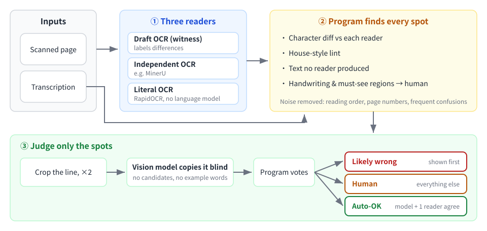
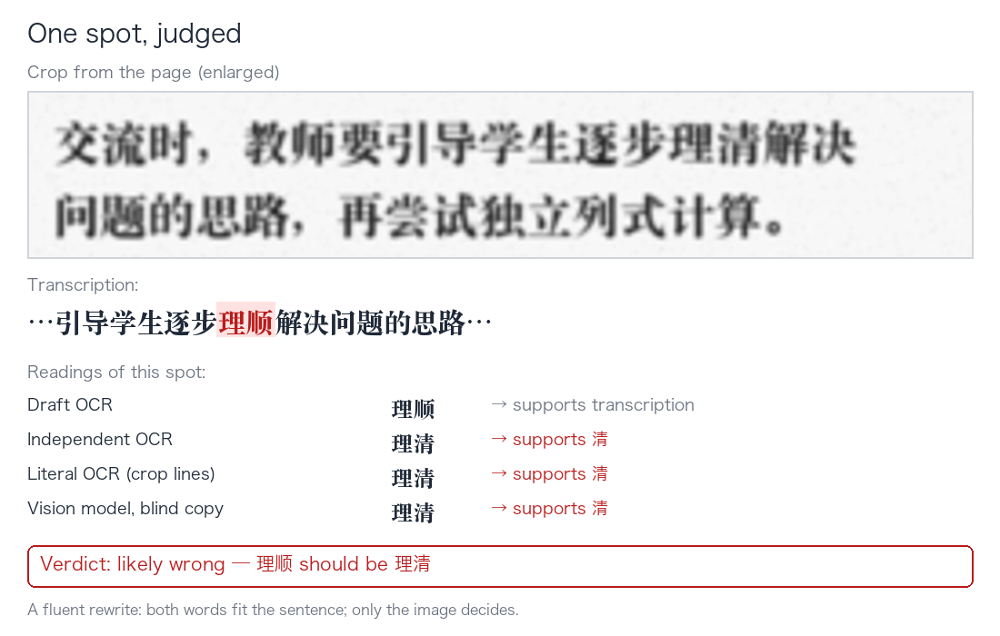
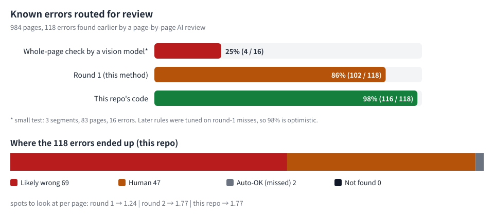

# ocr-proofread-triage: verbatim proofreading triage for transcriptions of scanned pages

**English** | [简体中文](README.zh-CN.md)



## What this is

Checking that a transcription of a scanned page matches the image *character for character* is split into two jobs:

1. **Find**: a program finds every spot that *might* be wrong. It only compares characters, so it does not skim
   and does not "know better".
2. **Judge**: a model or a person looks only at those spots, and each spot asks one narrow question: *which
   character is printed here?*

The approach comes from real work: a verbatim transcription of a scanned set of Chinese primary-school maths
teacher's guides, about 1,000 pages. This repo is the cleaned-up, general-purpose code plus a full write-up of the
method. **It contains no content from the books** (see [Copyright and data](#copyright-and-data)).

One spot, judged (the sentence is made up and the scan is simulated):



## Contents

- [The problem](#the-problem)
- [Why not let a vision model check whole pages](#why-not-let-a-vision-model-check-whole-pages)
- [Method](#method)
- [Results](#results)
- [Dead ends](#dead-ends)
- [Lessons](#lessons)
- [Limits](#limits)
- [Cost](#cost)
- [Quick start](#quick-start)
- [Data formats](#data-formats)
- [Relation to existing tools](#relation-to-existing-tools)
- [References](#references)
- [Copyright and data](#copyright-and-data)

## The problem

Our transcription rule is **verbatim**: every character, every punctuation mark, whether a space is there or not,
what a child actually wrote in a handwritten sample, and even the publisher's misprints are kept as printed. The
transcription was drafted by OCR and tidied by a large language model. The errors left over are mostly these:

| Type | Example (word level) | Why it is hard |
|---|---|---|
| Dropped character | 长方形**边**的特点 with 边 missing | the sentence still reads fine |
| Punctuation | enumeration comma 、 typed as comma ，; colon typed as semicolon | both marks make sense |
| Fluent rewrite | 明晰 → 明确, 可让 → 可以让 | the wrong version is more common, more fluent |
| Handwriting misread | a child's 几件 read as 四件, 第1天 read as 第一天 | the context makes the wrong reading look expected |
| Misprint silently fixed | the book prints 拆叠, transcribed as 折叠 | the rule is to keep the misprint, so "fixing" it is the error |
| Spaces and symbols | 大约 120, 表3-2 ，, a minus typed as a long dash 8—3 | almost invisible to the eye |

What these have in common: **the wrong version is usually more fluent than the original.** A human reader glides
past it, and a model judging by context picks the more fluent reading.

Our previous approach was to have a top-tier AI model review every page against its image.
It works, but it is expensive: 116 segments, a little over 2,900 pages, about USD 465 in equivalent API cost — about
USD 3.4 per segment of roughly 25 pages.

## Why not let a vision model check whole pages

We first tried the obvious: give a vision-language model (Zhipu GLM-5.3-Flash) one page image and its transcription
and ask it to list every difference. On 3 segments, 83 pages, 16 known errors:

| Setup | Found | Note |
|---|---|---|
| reasoning effort "high", prompt with examples of error types | 7/16 | the example words later turned out to be some of the answers |
| reasoning effort "max", same prompt | same as high on one segment (4/7) | about 7× slower per page |
| reasoning effort "high", **clean prompt without example words** | **4/16** | the real level |

It also reported many "differences". We checked 10 of them against the images: **every one was its own misreading.**
It flagged a correct 明确 as wrong and missed the real 明晰 error.

The reason is not hard to see. Checking a whole page makes the model read, compare and decide at the same time; what
it skims, it does not compare. And it leans toward the fluent reading — exactly the direction of the errors we want to
catch. Published work says the same: general vision-language models rewrite imperfect text into a more fluent form,
worst on short words (*Do VLMs Read or Rewrite?*, arXiv 2607.21617), and when shown candidate text they trust the text
over the image (*Blind faith in text*, CVPR 2025, arXiv 2503.02199).

**Deciding by context does not work either.** We went through the 16 errors one by one: context gets four or five
right (building a shape from paper strips is 搭出, not 描出), but for 明晰/明确, 可让/可以让 and 几件/四件 it confidently
picks the wrong one. The transcription errors were made precisely by a model "fixing" words by context; reviewing by
context repeats the same mistake. Context is good for one thing only: discarding OCR garbage that does not read at all.

## Method

### ① Three readers

A program cannot read an image, so someone has to turn the image into text first. One reader makes mistakes; three
independent readers usually make *different* mistakes, and comparing them exposes the errors.

| Role | What we used | Purpose |
|---|---|---|
| Witness | the OCR draft the transcription was made from (Unlimited-OCR) | only labels differences, produces no spots itself |
| Independent reader | a fresh MinerU reading | compared with the transcription; produces spots |
| Literal reader | RapidOCR (PP-OCRv5 server, local) | compared with the transcription; also gives each line's position on the page, used for cropping |

**Why one reader must be "literal".** OCR engines with a language model behave like the big models: they read words
into their fluent form. The book prints 拆叠; both language-model readers read 折叠, and only RapidOCR, which has no
language model, read 拆叠 as printed. Handwriting is the same story: a child wrote 几件, both older readers read 四件 —
the same mistake as the transcription — and only RapidOCR got it right.

`read_pages.py` runs RapidOCR. For the other two readers, any OCR output you already have will do (one text file per
page).

### ② Finding spots (`find_spots.py`)

**Normalize before comparing** (`core.normalize`): remove what readers format differently but does not matter
(spaces, table pipes, LaTeX, quote style, half/full-width commas and brackets), but **keep** what does matter:

- ～ and ~ are not merged: the book prints the full-width ～, so a half-width ~ in the transcription is an error;
- all minus signs and dashes become one "-" instead of being deleted. Our first version deleted "-", so 850-300 no
  longer matched a reader's 850—300, and false alarms piled up.

**Five sources of spots:**

1. **Character diff** (`core.compare`): the transcription against each independent reader; differences of at most 4
   characters are reported. Context extends only up to the neighbouring difference, so errors a few characters apart
   do not hide each other (we learned this the hard way: four "10:05" turned into "10.05" a few characters apart were
   all missed by an older version). The witness labels each difference; when the witness also has the other reading,
   the signal is strongest.
2. **House-style lint** (`core.lint`): layout errors that need no reader. Every rule caught a real error:
   - a space between a Chinese mark and a letter/digit: `“ x+2x=90 ”`
   - a space before a Chinese mark: `表3-2 ，`
   - a Chinese character, a space, then a digit: `大约 120`
   - a space after an ellipsis
   - a long dash used as a minus between digits: `8—3=5`
   - a half-width ~ and half-width punctuation (except inside numbers)
   - excluded: the unreadable mark `[?]`, time ranges `11:30—12:00`, handwriting lines and markup lines
3. **Text no reader produced** (`core.unread`): transcription text that none of the three readers produced — mostly
   text inside pictures. Nobody vouches for it, so a person must look.
4. **Handwriting lines**: every line starting with the handwriting prefix (手写：) goes to a person. Handwriting is
   where readers and the transcription most often share the same mistake, which a diff cannot see.
5. **Must-see regions** (`--always-human`): a regex marks whole regions a person must check. We used it to send every
   table of scanned student work to a person.

**Removing fixed noise:**

- **Reading order:** table cells such as 达到预期 / 超出预期 are read in different orders by different readers,
  producing swarms of "missing/extra" differences. A moved string of 4+ characters that appears elsewhere on the page
  is treated as reading order. We first set this to 2 characters, and a real dropped 表现 was thrown away because
  表现 also occurred elsewhere on the page.
- **Page numbers** read into the body text.
- **The literal reader's frequent confusions:** RapidOCR confuses some pairs in this typeface all the time, e.g. 己/已
  (296 times in the books) and 入/人 (89 times). A lone disagreement is dropped only when its pair occurs 3+ times in
  the run *and* every other reading supports the transcription. **Rare lone disagreements are always kept**, because
  the literal reader is often the only one that reads a misprint as printed. Our first rule ("drop it when the other
  two agree with the transcription") threw away 拆叠.

### ③ Judging (`crop_spots.py`, `judge.py`)

**Crop:** using the line boxes from RapidOCR, find the line whose text best matches the spot's context, add the
vertically adjacent lines that overlap it horizontally (spots often sit at a line break), pad by 10 px and enlarge
2×. Research agrees that vision models read small print much worse, and that cropping and enlarging helps.

**Blind copy:** the crop goes to a vision model with a one-sentence prompt (in Chinese):

> 请把图中的文字逐字照抄出来，包括所有标点符号。严格照原样：不要改正、不要补全、不要改写，也不要加任何解释。看不清的字写□。只输出抄写结果。
>
> *(Copy the text in the image character by character, with all punctuation. Exactly as it is: do not correct,
> complete or rewrite, and add no explanation. Write □ for what you cannot read. Output only the copy.)*

- **No candidate readings:** shown text, the model trusts the text.
- **No example words:** our first prompt had examples, the examples were answers, and the score was inflated.
- Reads are cached by the crop's content hash, so re-runs cost nothing.

**Vote** (`core.vote`, `core.verdict`): every reading — the model's copy, RapidOCR's lines inside the crop, and each
reader's page text — is checked: does it support the transcription, the alternative, both or neither? Context may be
anchored on one side only, because spots often sit at the edge of a table cell.

| Verdict | Condition |
|---|---|
| Auto-OK | the model supports the transcription, at least one other reader does too, and at most one reader is against it |
| Likely wrong | the model supports the alternative. These are shown first |
| Human | everything else |

"At most one reader against" was added after a miss: in a reference list the book prints a comma after an author's
name; the model, following the usual citation style, read a colon, one reader happened to agree, and the spot was
released. When two readers contradict the transcription, the model alone must not overrule them.

**What a person finally sees:** the crops judged "likely wrong" and "human", the lint hits, the text no reader produced,
the handwriting lines and the must-see regions. When the image resolution is not enough to decide, crop the same
character from elsewhere in the same book and compare the shapes side by side (see Lesson 4).

## Results



Data: a scanned set of Chinese primary-school maths teacher's guides, 41 segments, 984 pages. All of them had been
reviewed page by page against the images by a top-tier AI model, but not yet corrected, so every error that review
reported was still in the text. We collected the review's must-fix findings and kept the 118 that are clearly about the text itself as the
answer key.

| Run | Routed for review | of which "likely wrong" | Wrongly auto-released | Not found | Spots to look at |
|---|---|---|---|---|---|
| Round 1 | 102 (86%) | 66 | 3 | 13 | 1.24 per page, plus 107 student-work tables |
| Round 2 (rules added) | 115 (97%) | 68 | 2 | 1 | 1.77 per page, plus 107 tables |
| This repo's code | 115 (97%) | 68 | 2 | 1 | 1.86 per page, plus 114 must-see regions |

**Please note:**

- **Round 2's 97% is optimistic.** The rules added in round 2 were written while looking at round 1's misses. The real
  level should be measured on fresh data.
- **The answer key contains only errors the AI review found.** Errors it missed are not in it, so this measures "does
  it find what the review found", not an absolute recall.
- **About 40% of "likely wrong" spots are real errors** (68/158 in the experiment scripts, 68/170 with this repo's
  code). Some of the rest, which the review did not report, may be errors it missed; we have not checked them all.
- **The 3 spots round 2 still lost:**
  - the first 拆叠: the model and the two older readers all read 折叠, 3 against 1, only RapidOCR was right;
  - one spot in a flow chart: every reader read the boxes in a different order, so the diff could not line up;
  - one minus typed as a long dash: the first one on the page was caught by the lint, the second was not; not yet
    investigated.
- This repo's code is a cleaned-up, general version of the experiment scripts, re-run on the same data: the routed,
  wrongly released and missed errors are exactly the same; because frequent confusions are now learned per book, there
  are slightly more spots to look at (1.86 per page).

## Dead ends

| Tried | Result | Conclusion |
|---|---|---|
| Vision model checks whole pages | 4/16 with a clean prompt, many false alarms | dropped |
| Example error words in the prompt | the examples were answers; inflated score | no concrete words in prompts |
| Maximum reasoning effort | finds no more, ~7× slower | use "high" |
| Deciding by context | systematically picks the fluent wrong version | context only discards garbage |
| Scoring every transcription character with the OCR model (CTC forced alignment) | lines and text did not align well; dozens of low scores per page | not used for now; may help once alignment is right |
| "Drop the third reader's objection when the other two agree" | killed a real misprint | drop only frequent confusion pairs |
| Reading-order filter at 2 characters | dropped a real missing word | 4+ characters |

## Lessons

1. **Separate finding from judging.** Finding goes to a program, which does not skim; judging gets only narrow
   questions, and the narrower the question, the better the model.
2. **The wrong version is usually the more fluent one.** Anything with a language model in it — large models, OCR
   with a language model, a human reading by feel — errs toward fluency. You need a "literal" reader without a
   language model, and a majority must not easily overrule its lone objection.
3. **No answers in the prompt, and no candidates.** Examples leak answers; candidates make the model trust the text.
4. **At low resolution, compare with the same character elsewhere in the same book.** We once believed the book
   printed 进人 instead of 进入: GLM, RapidOCR and our own eyes all said so. Enlarging a known 人 and two certain
   引入 from the same book side by side showed that in this typeface, scanned, 入 has a small hook to the upper left —
   the character was 入, and the finding was withdrawn. RapidOCR reads 入 as 人 89 times in this book.
5. **Validate every rule on known errors, then look at the noise it adds.** Round 2 raised routing from 86% to 97%
   and the number of spots by 40%. Choose that trade-off for your own needs.

## Limits

- Tested on one set of books with one layout. The rules include Chinese typesetting habits and our own transcription
  conventions (markers like "[页眉]" and "手写："); adjust the constants at the top of `core.py` for other data.
- Text inside flow charts and diagrams: once the reading order is scrambled, the diff cannot line up; for now it only
  reaches a person through "text no reader produced".
- There is still a fair amount to look at (about 1.9 spots per page); it just changes from "read every page top to
  bottom" to "look at small crops".
- The vote leans on the model's copy; with another model, recalibrate on known errors first.

## Cost

- Reading pages (RapidOCR) runs locally: on a 15-core Mac with four processes, 984 pages take about an hour.
- Blind copies: about 1,200 crops (round 1) to 2,200 (this repo's code); GLM-5.3-Flash with 8 parallel requests does
  about 1,000 crops in 15–20 minutes. Re-runs reuse cached reads by image hash.
- For comparison: a page-by-page review by a top-tier AI model of the same 41 segments costs about 41 × USD 3.4 ≈ USD 140, often
  with over a hundred turns per segment.
- What a person or a strong model finally looks at: about 1.9 spots per page, mostly small crops.

## Quick start

```bash
git clone https://github.com/lixiaoqi888/ocr-proofread-triage
cd ocr-proofread-triage
python3 -m venv .venv && .venv/bin/pip install -r requirements.txt
python3 tests/test_core.py            # self-check, needs no data
```

Prepare a working folder (`work/` is in `.gitignore`), one file per page with the same file name everywhere:

```
work/
  pages/      p001.md p002.md …    your transcription, one file per page
  images/     p001.jpg p002.jpg …  the page images
  witness/    p001.md …            the OCR draft the transcription was made from (or any reader)
  reader2/    p001.md …            another independent OCR reading, e.g. MinerU
```

```bash
# ① the literal reader: RapidOCR reads the pages, giving text and line boxes
.venv/bin/python read_pages.py work/images work/rapid

# ② find spots
.venv/bin/python find_spots.py --final work/pages --witness work/witness \
    --reader mineru=work/reader2 --reader rapid=work/rapid \
    --filter-reader rapid --always-human "学生作答典型表现" --out work/spots.json

# ③ crop
.venv/bin/python crop_spots.py work/spots.json work/rapid work/images work/crops

# ④ blind copy and vote (any OpenAI-compatible model with image input)
export VLM_API_KEY=...                 # defaults to glm-5.3-flash on Zhipu's open platform
.venv/bin/python judge.py work/spots.json work/crops --witness work/witness \
    --reader mineru=work/reader2 --reader rapid=work/rapid --boxes-reader rapid \
    --out work/verdicts.json

# ⑤ (optional) score against a list of known errors
.venv/bin/python score.py work/spots.json work/verdicts.json work/truth.json
```

To switch models, set `VLM_BASE_URL` (default `https://open.bigmodel.cn/api/paas/v4`), `VLM_MODEL` and `VLM_EXTRA`
(JSON merged into the request; the default enables GLM thinking with reasoning effort "high").

The figures are drawn by `docs/make_figures.py`.

## Data formats

**`spots.json`** (output of `find_spots.py`)

```json
{
  "spots": [
    {"source": "work/pages", "page": "p012", "src": "mineru+rapid", "kind": "final-differs-from-both",
     "left": "逐步理", "final": "清", "alt": "顺", "alts": ["顺", "顺"], "right": "思路后"}
  ],
  "always_human": [{"source": "work/pages", "page": "p031", "text": "…the whole region's text…"}],
  "dropped": {"reading-order": 23, "page-number": 5, "confusion": 115},
  "confusions": [["rapid", "己", "已", 296]]
}
```

- `src`: who reported it — a reader name (joined with `+` when several readers report the same spot), `lint`,
  `unread` or `handwriting`.
- `final` and `alt`: the transcription's text and the reader's text, both normalized; `left` and `right` are context.

**`verdicts.json`** (output of `judge.py`): one entry per crop — the spot, the model's copy, each reading's vote
(`[supports transcription, supports alternative]`) and the verdict `auto-ok` / `likely-wrong` / `human`.

**`truth.json`** (optional, for scoring):

```json
[{"source": "work/pages", "page": "p012", "current": "逐步理清思路", "key": "理清", "type": "错字"}]
```

## Relation to existing tools

We searched GitHub and found nothing ready-made for Chinese that chains "compare several OCR readings → crop →
model or human decides":

- multi-OCR voting projects (ROVER-style) are archived or split text into English words;
- human proofreading platforms (e.g. eScriptorium) have the right interface but are heavy to deploy;
- ocr-verify is the closest idea (an old-style OCR as a "witness", every disagreement shown with a crop) but supports
  Latin script only.

Parts used here: RapidOCR / PaddleOCR's PP-OCRv5 models and Python's `difflib`. The idea of "release only when several
independent readers agree" matches research such as Consensus Entropy (CVPR 2026, arXiv 2504.11101) and Double
Triangle (arXiv 2605.25781).

## References

- *Do VLMs Read or Rewrite?* arXiv 2607.21617 — general vision-language models rewrite text into a more fluent form;
  traditional OCR is much less affected.
- *Blind faith in text*, CVPR 2025, arXiv 2503.02199 — when image and text disagree, models trust the text.
- *Consensus Entropy*, CVPR 2026, arXiv 2504.11101 — several models reading independently and checking agreement finds
  errors far better than one model acting as judge.
- *MLLMs know where to look*, ICLR 2025 — cropping and enlarging improves reading of small details.
- [RapidOCR](https://github.com/RapidAI/RapidOCR), [PaddleOCR](https://github.com/PaddlePaddle/PaddleOCR).

## Copyright and data

This repo contains **only code and the method write-up** — no page images, transcriptions, crops, model copies or
answer lists. The examples are short, word-level, or made up; the figures use made-up text. The books used in the tests
are under copyright and are not published.

## License

[MIT](LICENSE)
