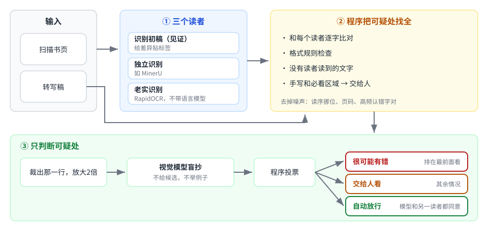
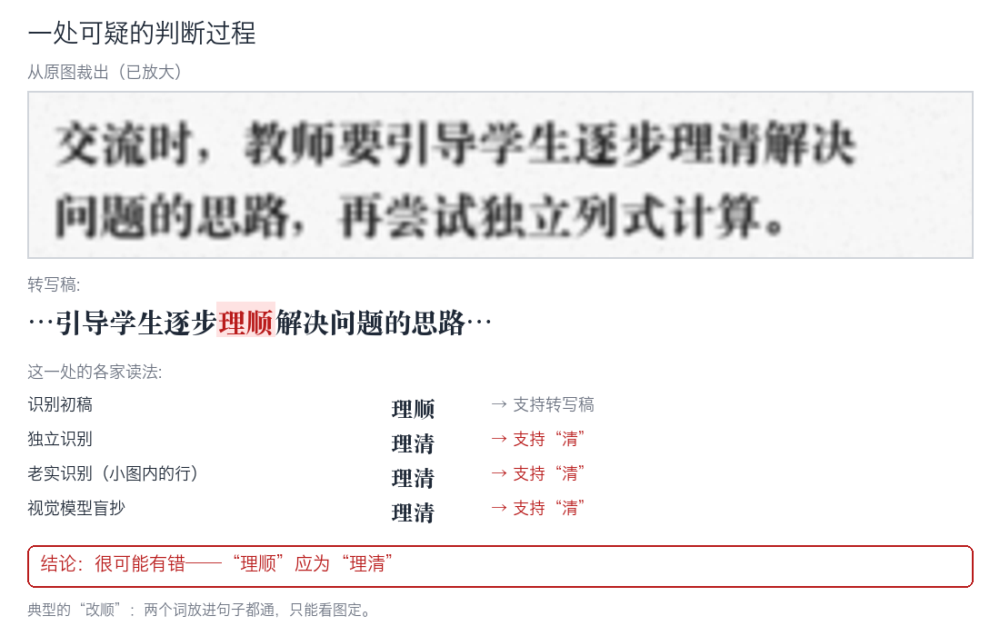
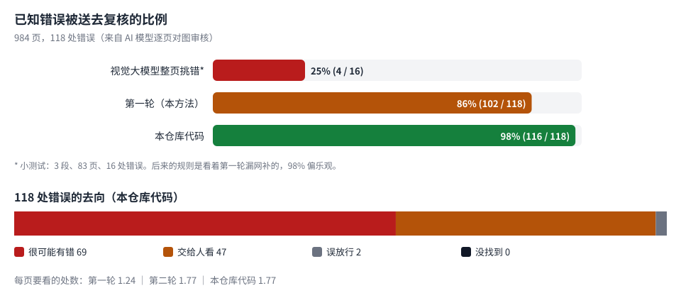

# ocr-proofread-triage：扫描书页转写稿的逐字核对分诊

[English](README.md) | **简体中文**



## 这是什么

把“扫描书页的转写稿要逐字对得上原图”这件事，拆成两步：

1. **找**：程序把所有**可能**错的地方找全。程序只比字，不会看漏，也不会自作主张。
2. **判**：模型和人只看被找出来的地方，每处只问一个问题：“图上印的是哪个字”。

这套做法来自我们给一套扫描版小学数学教师用书（约 1000 页）做逐字转写和核对的实际工作。本仓库是整理后的通用代码和完整的方法说明，**不含任何原书内容**（见文末“版权与数据”）。

下面是一处可疑的判断过程（图中句子是编的，扫描效果是模拟的）：



## 目录

- [要解决的问题](#要解决的问题)
- [为什么不让视觉大模型整页挑错](#为什么不让视觉大模型整页挑错)
- [方法](#方法)
- [实测结果](#实测结果)
- [走过的弯路](#走过的弯路)
- [教训](#教训)
- [局限](#局限)
- [成本](#成本)
- [快速开始](#快速开始)
- [数据格式](#数据格式)
- [和已有工具的关系](#和已有工具的关系)
- [参考](#参考)
- [版权与数据](#版权与数据)

## 要解决的问题

我们的转写要求是**照原样**：每个字、每个标点、空格的有无，学生手写样例里写的什么，甚至原书印错的字，都要照录。转写稿由识别软件出初稿、大模型整理而成，最后留下的错误主要是这几类：

| 类型 | 例子（词语级） | 难在哪里 |
|---|---|---|
| 漏字 | “长方形边的特点”漏了“边” | 漏了以后句子照样通顺 |
| 标点 | 顿号写成逗号，冒号写成分号 | 两种标点都说得通 |
| 改顺 | “明晰”写成“明确”，“可让”写成“可以让” | 错的版本更常见、更通顺 |
| 手写读错 | 学生写的“几件”读成“四件”，“第1天”读成“第一天” | 上下文让人以为本该如此 |
| 原书印错被悄悄改正 | 原书印“拆叠”，转写成了“折叠” | 规则是照录原印，改对了反而是错 |
| 空格与符号 | “大约 120”，“表3-2 ，”，减号打成长横“8—3” | 肉眼几乎看不见 |

这些错误有个共同点：**错的版本往往比原文更通顺**。人读着顺就放过去了，模型凭上下文判断也会选更顺的那个。

我们原来的做法是让一个顶级 AI 模型逐页对图审核。有效，但贵：116 段、2900 多页，审一遍约 465 美元（等价 API 费用），每段约 25 页、约 3.4 美元。

## 为什么不让视觉大模型整页挑错

我们先试了最直接的办法：把一页原图和它的转写稿一起交给视觉大模型（智谱 GLM-5.3-Flash），让它列出所有不一致。在 3 段、83 页、16 处已知错误上：

| 做法 | 找到 | 说明 |
|---|---|---|
| 推理强度 high，提示词里举了错误类型的例子 | 7/16 | 后来发现举的例子恰好就是答案里的几个词 |
| 推理强度 max，同样的提示词 | 二下那段与 high 相同（4/7） | 每页慢约 7 倍 |
| 推理强度 high，**去掉例子词**的干净提示词 | **4/16** | 这才是真实水平 |

它另外报了很多“问题”，我们对原图核了其中 10 处，**全是它自己看错了**：把对的“明确”报成错，真正错的“明晰”反而漏掉。

原因不难理解：整页挑错要模型一边读、一边比、一边判断，读漏了就比漏了；它又天然倾向于更通顺的读法，正好和我们要抓的错方向一致。已有研究也说明了这一点：通用视觉大模型会把不完美的文字“改写”成更通顺的形式，短词最严重（*Do VLMs Read or Rewrite?*, arXiv 2607.21617）；给它看候选文字，它会偏信文字而不是图（*Blind faith in text*, CVPR 2025, arXiv 2503.02199）。

**也不能凭语境判断谁对。** 我们逐条想过：16 处真错里，靠语境能判对的只有四五处（比如用纸条“搭出”图形比“描出”合理）；“明晰/明确”“可让/可以让”“几件/四件”这些，语境会坚定地选错的那个。当初转写出错，正是因为模型凭语境把字改顺了；再用语境来审，会重犯同一种错。语境唯一能做的，是清掉明显读不通的识别乱码。

## 方法

```
页图 ──► ① 三个读者各读一遍 ───────────────────────────────┐
                                                          ▼
转写稿 ─────────────────────────────► ② 程序找可疑处：逐字比对 ＋ 格式规则 ＋ 没人读到的字 ＋ 手写/必看区域
                                                          │
                                                          ▼
                     ③ 按行裁图、放大 ──► 视觉模型盲抄（不给候选、不举例）──► 程序投票
                                                          │
                                                          ▼
                     自动放行  ／  很可能有错（先看） ／  交给人看
```

### ① 三个读者

程序自己看不懂图，需要先有人把图“读成字”。一个读者会读错，三个独立读者各读一遍，错的地方一般不一样，一比就露出来。三个读者的分工：

| 角色 | 我们用的 | 作用 |
|---|---|---|
| 见证读者（witness） | 转写稿所依据的识别初稿（Unlimited-OCR） | 只用来给差异贴标签，不单独产生可疑处 |
| 独立读者 | MinerU 的重新识别 | 和转写稿逐字比，产生可疑处 |
| 老实读者 | RapidOCR（PP-OCRv5 server，本地） | 和转写稿逐字比；同时提供每一行在图上的位置，用来裁图 |

**为什么必须有一个“老实读者”：** 带语言模型的识别软件和大模型一样，会把字往通顺里读。原书印“拆叠”，两个带语言模型的读者都读成“折叠”，只有不带语言模型的 RapidOCR 照实读成“拆叠”。手写也是：学生写的“几件”，两个旧读者都读成“四件”，和转写稿错在同一处，只有 RapidOCR 读对。

本仓库的 `read_pages.py` 负责用 RapidOCR 读图；另外两个读者用你手头已有的任何识别结果（每页一个文本文件）即可。

### ② 找可疑处（`find_spots.py`）

**比对前先归一化**（`core.normalize`）：去掉各家格式不同但无关紧要的东西（空格、表格竖线、LaTeX 写法、引号样式、逗号括号的全半角），但**保留**要紧的差别：

- “～”和“~”不合并：原书印全角，转写成半角就是错；
- 各种减号、长横统一记作一个“-”，而不是删掉。我们最初的版本把“-”删了，导致“850-300”和读者的“850—300”对不上，冒出大量误报；
- 读者读出的半角“~”算作书上印的“～”（识别软件几乎总是输出半角），只有转写稿自己的全角半角才检查，由格式规则负责。读者把一字线读成汉字“一”的，也不算差异，真正的误用由格式规则查。

**可疑处的五个来源：**

1. **逐字比对**（`core.compare`）：转写稿对每个独立读者，找出不超过 4 个字的短差异。上下文只延伸到相邻差异为止，所以挨得很近的几处错不会互相遮住（我们吃过亏：相隔几个字的四处“10:05”被改成“10.05”，旧版一处都没报出来）。每处差异用见证读者贴标签：见证读者也读成另一种的，信号最强。
2. **格式规则**（`core.lint`）：不需要读者就能查的版式错误。每条规则都抓到过真错：
   - 中文标点和字母、数字之间的空格：`“ x+2x=90 ”`
   - 中文标点前的空格：`表3-2 ，`
   - 汉字后空格再接数字：`大约 120`
   - 省略号后的空格
   - 数字之间用长横当减号：`8—3=5`，或者用汉字“一”当减号：`8一3=5`
   - 两个词之间用了短横：`甲地-乙地`（书上用一字线“—”连接）
   - 半角“~”和半角标点（数字内部的除外）
   - 排除：看不清标记 `[?]`、时间段 `11:30—12:00`、手写行和标记行
3. **没人读到的字**（`core.unread`）：转写稿里有、三个读者都没读出来的文字，多半是图片里的字。没有任何读者为它作证，必须有人看。
4. **手写行**：凡以“手写：”开头的行，一律交给人看。手写最容易出现“读者和转写稿错在同一处”，比对看不出来。
5. **必看区域**（`--always-human`）：用正则指定一定要人看的整块区域。我们用它把所有“学生作答典型表现描述”表（满是学生手写的样例）整表交给人。

**去掉固定噪声：**

- **读序挪位：** 表格里的“达到预期”“超出预期”这类格子，各家读的顺序不同，会冒出成片的“少了/多了”。被挪动的串在 4 个字以上、且在页上别处出现，就当读序问题丢掉。最初我们设成 2 个字，结果“表现”两个字因为页上别处也有，一处真实的漏字被丢了。
- **页码：** 读者把页码读进正文。
- **老实读者的高频认错字对：** RapidOCR 对这套字体有固定的认错，比如“己/已”（全书 296 次）、“入/人”（89 次）。规则是：只有当这个字对在全部数据里出现 3 次以上、并且其他所有读者都和转写稿一致时，才丢掉。**少见的单独异议一律保留**，因为老实读者常常是唯一读对原书印错的那个。我们最初用的是“另两家都同意转写稿就丢”，结果误杀了“拆叠”。

### ③ 判断（`crop_spots.py`、`judge.py`）

**裁图：** 用 RapidOCR 给出的行框，找到和可疑处上下文最匹配的那一行，连同上下相邻、水平重叠的行一起裁出来（可疑处常在换行处），四周留白 10 像素，放大 2 倍。研究也表明，视觉模型看小字明显变差，裁剪放大有帮助。

**盲抄：** 把小图交给视觉模型，提示词只有一句：

> 请把图中的文字逐字照抄出来，包括所有标点符号。严格照原样：不要改正、不要补全、不要改写，也不要加任何解释。看不清的字写□。只输出抄写结果。

- **不给候选读法：** 给了它就偏信给的文字；
- **不举任何例子词：** 我们第一次就是在提示词里举了例子，结果例子恰好是答案，测试成绩虚高；
- 抄写结果按图片内容的哈希缓存，重跑不重复花钱。

**投票**（`core.vote`、`core.verdict`）：每个读法（模型的抄写、小图里 RapidOCR 读出的行、每个读者的整页读法）都看它支持转写稿、支持另一种读法、两者都支持还是都不支持。上下文允许只锚住一侧，因为可疑处常在表格格子的边上。

| 结论 | 条件 |
|---|---|
| 自动放行 | 模型支持转写稿，另有至少一个读者也支持，且反对转写稿的读者不超过一个 |
| 很可能有错 | 模型支持另一种读法。这一类排在最前面给人看 |
| 交给人看 | 其余情况 |

“反对的读者不超过一个”这一条是后加的：有一处参考文献，原书在作者名后印的是逗号，模型照着常见的引文格式读成了冒号，碰巧有一个读者附和，于是被错误放行。两个读者都反对转写稿时，不能只信模型。

**人最后看到的：** “很可能有错”和“交给人看”的小图、格式规则命中的位置、没人读到的文字、手写行和必看区域。判断时，图分辨率不够，就把同一本书里同一个字的其他写法裁出来并排对照（见“教训”第 4 条）。

## 实测结果



数据：一套扫描版小学数学教师用书，41 段、984 页。这些段落都已由一个顶级 AI 模型逐页对图审过，但审后还没改，所以审核报出的错仍原样留在稿子里。我们把审核报出的必改项整理出来，取其中确定属于文字本身的 118 处作为标准答案。

| 轮次 | 送去看 | 其中“很可能有错” | 误放行 | 漏掉 | 要看的处数 |
|---|---|---|---|---|---|
| 第一轮 | 102（86%） | 66 | 3 | 13 | 每页 1.24 处，另有样例表 107 张 |
| 第二轮（补规则后） | 115（97%） | 68 | 2 | 1 | 每页 1.77 处，另有样例表 107 张 |
| 本仓库代码重跑 | 116（98%） | 69 | 2 | 0 | 每页 1.77 处，另有必看区域 114 块 |

**请注意以下几点：**

- **第二轮的 97% 偏乐观。** 第二轮补的规则，是看着第一轮漏网的错写的。真实水平应该在新的数据上再测。
- **标准答案只包括这次 AI 审核找到的错。** 审核也漏掉的错不在里面，所以这里测的是“能不能找到审核找到的”，不是绝对的找到率。
- **“很可能有错”一类里约一半是真错**（实验脚本 68/158，本仓库代码 69/138）。其余审核没报的，其中可能有审核漏掉的真错，我们还没逐一核实。
- **第二轮仍然漏掉的 3 处：**
  - 第一处“拆叠”：模型和两个旧读者都读成“折叠”，3 比 1，只有 RapidOCR 对；
  - 流程图里的一处：各家读的顺序全乱，比对对不上位置；
  - 一处减号打成长横：同页第一处被格式规则抓到，第二处没有，原因还没查。
- 本仓库代码是实验脚本整理后的通用版本，在同一批数据上重跑。它还认得表示范围和连接的符号（见“教训”第 6 条），去掉了大量误报，每页要看 1.77 处。上面那处减号打成长横的，格式规则其实抓到了，是实验时的打分没对上；另外两处仍然漏掉。

## 走过的弯路

| 试过的 | 结果 | 结论 |
|---|---|---|
| 视觉大模型整页挑错 | 干净提示词下 4/16，误报多 | 放弃 |
| 提示词里举错误例子 | 例子恰好是答案，成绩虚高 | 提示词不举具体词 |
| 推理强度开到最高 | 找到的没有更多，慢约 7 倍 | 用 high |
| 凭语境判断谁对 | 会系统性地选更通顺的错版本 | 语境只用来清掉乱码 |
| 用识别模型给转写稿的每个字打可信度分（CTC 强制对齐） | 定稿和图上各行对不准，每页几十个低分字，噪声太大 | 暂不用；对齐做好了也许有用 |
| “两家读者同意转写稿就丢掉第三家的异议” | 误杀原书印错 | 改成只丢高频认错字对 |
| 读序过滤设成 2 个字 | 误丢真实漏字 | 改成 4 个字以上 |

## 教训

1. **找和判分开。** 找交给程序，因为程序不会看漏；判只问窄问题，问题越窄，模型越准。
2. **错的往往更通顺。** 凡是带语言模型的东西（大模型、带语言模型的识别软件、人凭语感），都会往通顺的方向错。必须有一个不带语言模型的“老实读者”，而且多数一致也不能轻易盖过它的少数意见。
3. **提示词不能带答案，也不要给候选。** 举例会泄题，给候选会让模型偏信文字。
4. **低分辨率下判字，要拿同一本书里的同一个字对照。** 我们曾以为一处“进入”原书印成了“进人”：GLM、RapidOCR 和我们自己的肉眼都这么看。把同书的“人”和两处确定是“引入”的字放大并排一比，才发现这套字体扫描后的“入”顶上有个向左的小钩，那个字就是“入”，结论撤回。RapidOCR 在这本书里把“入”读成“人”有 89 次。
5. **每条规则都要拿已知错误验证，再看它带来多少噪声。** 第二轮把找到率从 86% 提到 97%，要看的处数也多了四成。这个取舍要按自己的需要定。
6. **先认清符号，给人看的必须是原字。** 数学文字里，“～”表示“至”（1～10 就是 1 到 10），一字线“—”把前后连成顺序或路线（今天—明天—后天、甲地—乙地），“——”是破折号，我们的转写里“-”只当减号。识别软件经常把“～”读成“~”、把“—”读成“一”，规则不认得这些符号，就会冒出成片的误报。我们第一版核对页显示的是比对用的归一化文字，所有横线都显示成“-”，结果把对的一字线判成了错；给人看的页面必须显示转写稿里的原字。

## 局限

- 只在一套书、一种排版上测过；规则里有中文排版习惯和我们自己的转写约定（如“[页眉]”“手写：”标记），换数据要调整 `core.py` 顶部的常量。
- 流程图、示意图里的字，读序一乱，比对就对不上；目前只能靠“没人读到的字”交给人看。
- 要人看的地方仍然不少（每页约 1.8 处），只是从“每页从头读到尾”变成了“看一张张小图”。
- 投票规则对模型抄写的依赖较大；换了模型，最好先用已知错误重新校一遍。

## 成本

- 读图（RapidOCR）在本地跑，一台 15 核的 Mac 上四个进程并行，984 页约 1 小时。
- 模型盲抄：约 1200 张小图（第一轮）到 2200 张（本仓库代码），GLM-5.3-Flash 8 路并发每千张约 15—20 分钟；重跑时按图片哈希复用，不重复花钱。
- 对照：顶级 AI 模型逐页对图审，同样规模约 41 段 × 3.4 美元 ≈ 140 美元，每段动辄上百轮对话。
- 人或强模型最后要看的，是每页约 1.8 处（多数是小图）。

## 快速开始

```bash
git clone https://github.com/lixiaoqi888/ocr-proofread-triage
cd ocr-proofread-triage
python3 -m venv .venv && .venv/bin/pip install -r requirements.txt
python3 tests/test_core.py            # 自检，不需要任何数据
```

准备一个工作目录（`work/` 已在 `.gitignore` 里），假设每页一个文件名相同的文件：

```
work/
  pages/      p001.md p002.md …    你的转写稿，一页一个文件
  images/     p001.jpg p002.jpg …  原图
  witness/    p001.md …            转写所依据的识别初稿（没有的话，用任意一个读者）
  reader2/    p001.md …            另一个独立识别结果，比如 MinerU
```

```bash
# ① 老实读者：RapidOCR 读图，得到文字和行框
.venv/bin/python read_pages.py work/images work/rapid

# ② 找可疑处
.venv/bin/python find_spots.py --final work/pages --witness work/witness \
    --reader mineru=work/reader2 --reader rapid=work/rapid \
    --filter-reader rapid --always-human "学生作答典型表现" --out work/spots.json

# ③ 裁图
.venv/bin/python crop_spots.py work/spots.json work/rapid work/images work/crops

# ④ 盲抄和投票（任何兼容 OpenAI 接口、支持图片输入的模型都可以）
export VLM_API_KEY=...                 # 默认是智谱开放平台的 glm-5.3-flash
.venv/bin/python judge.py work/spots.json work/crops --witness work/witness \
    --reader mineru=work/reader2 --reader rapid=work/rapid --boxes-reader rapid \
    --out work/verdicts.json

# ⑤（可选）如果你手上有已知错误清单，可以打分
.venv/bin/python score.py work/spots.json work/verdicts.json work/truth.json
```

换模型只要改环境变量：`VLM_BASE_URL`（默认 `https://open.bigmodel.cn/api/paas/v4`）、`VLM_MODEL`、`VLM_EXTRA`（并进请求体的 JSON，默认开启 GLM 的思考、推理强度 high）。

文中配图由 `docs/make_figures.py` 生成。

## 数据格式

**`spots.json`**（`find_spots.py` 输出）

```json
{
  "spots": [
    {"source": "work/pages", "page": "p012", "src": "mineru+rapid", "kind": "final-differs-from-both",
     "left": "逐步理", "final": "清", "alt": "顺", "alts": ["顺", "顺"], "right": "思路后"}
  ],
  "always_human": [{"source": "work/pages", "page": "p031", "text": "…整块区域的原文…"}],
  "dropped": {"reading-order": 23, "page-number": 5, "confusion": 115},
  "confusions": [["rapid", "己", "已", 296]]
}
```

- `src`：哪个来源报的，可以是读者名（多个读者报同一处时用 `+` 连起来）、`lint`、`unread`、`handwriting`。
- `final` 和 `alt`：转写稿的写法和读者的写法，都是归一化后的文字；`left`、`right` 是前后文。

**`verdicts.json`**（`judge.py` 输出）：每张小图一条，包括对应的可疑处、模型抄写的文字、各读者的投票（`[支持转写稿, 支持另一种]`）和结论 `auto-ok` / `likely-wrong` / `human`。

**`truth.json`**（打分用，可选）：

```json
[{"source": "work/pages", "page": "p012", "current": "逐步理清思路", "key": "理清", "type": "错字"}]
```

## 和已有工具的关系

我们在 GitHub 上找过：没有找到能直接用于中文、把“多个识别结果比对 → 裁图 → 人或模型裁定”串起来的现成工具。

- 多 OCR 投票（ROVER 一类）的项目，要么已归档，要么只按英文单词切分；
- 人工校对平台（如 eScriptorium）界面合适，但部署很重；
- ocr-verify 的思路最接近（拿老式 OCR 当“证人”，每处分歧配一张原图裁剪），但只支持拉丁字母。

本仓库用到的零件：RapidOCR / PaddleOCR 的 PP-OCRv5 模型，以及 Python 标准库的 `difflib`。“多个独立读者一致才放行”的思路，和 Consensus Entropy（CVPR 2026, arXiv 2504.11101）、Double Triangle（arXiv 2605.25781）这些研究的结论一致。

## 参考

- *Do VLMs Read or Rewrite?* arXiv 2607.21617：通用视觉大模型会把文字改写得更通顺，传统 OCR 受影响小得多。
- *Blind faith in text*, CVPR 2025, arXiv 2503.02199：图文矛盾时，模型偏信文字。
- *Consensus Entropy*, CVPR 2026, arXiv 2504.11101：多个模型独立读、看是否一致，查错效果明显好于单个模型当裁判。
- *MLLMs know where to look*, ICLR 2025：裁剪放大能提升小字细节的识别。
- [RapidOCR](https://github.com/RapidAI/RapidOCR)、[PaddleOCR](https://github.com/PaddlePaddle/PaddleOCR)。

## 版权与数据

本仓库**只有代码和方法说明**，不含任何书页图片、转写稿、裁剪小图、模型抄写结果或标准答案清单。说明中的例子都是词语级的短例或编的句子，配图里的文字也是编的。实测用的原书受版权保护，未公开。

## License

[MIT](LICENSE)
